## About Me

AI Developer and Data Analyst with hands-on experience in applied data science, computer vision, and predictive modeling. I turn raw data into actionable insights using SQL and Power BI, and build end-to-end machine learning pipelines with Python, scikit-learn, and FastAPI. I have trained CNN and MobileNetV2 models and fine-tuned YOLOv11 for real-time object detection.

Currently pursuing a BS in Artificial Intelligence at **Dawood University of Engineering & Technology (DUET), Karachi**.

## Experience

**Junior Data Analyst** · Nodebook Private Limited · Karachi, Pakistan · *Oct 2025 – Jan 2026*

- Cleaned and organized 10+ raw datasets using Excel and SQL, improving data accuracy by about 30%
- Built 5+ interactive Power BI dashboards tracking 15+ KPIs for stakeholders
- Performed exploratory analysis with Python (Pandas, Matplotlib) on 50,000+ records
- Ran competitor analysis across 8+ market players to support strategic planning

## Selected Projects

**PPE Detection System: Real-Time Computer Vision Pipeline**
Detects safety gear (cap, safety glasses, gloves, helmet) in live video for workplace compliance.
Python · YOLOv11 · PyTorch · OpenCV · [Repository](https://github.com/AreebAbdulGhani76/Project-of-ML)

**Real-Time Facial Emotion Detection**
Classifies 7 emotions from a webcam feed, comparing a custom CNN against transfer learning with MobileNetV2 on FER-2013.
TensorFlow/Keras · OpenCV · MobileNetV2 · [Repository](https://github.com/AreebAbdulGhani76/CV-CCP)

**Telco ChurnIQ: End-to-End Production ML Pipeline**
Customer churn prediction with leak-free feature engineering, 85.0% ROC-AUC, a FastAPI inference service (<50ms latency), and a dashboard.
Python · scikit-learn · XGBoost · MLflow · FastAPI · Docker · GitHub Actions · Prometheus · [Repository](https://github.com/AreebAbdulGhani76/ChurnIQ)

## Skills

- **Languages:** Python, C, C++, SQL
- **AI & ML:** Machine Learning, Deep Learning, Computer Vision, LLMs, AI Automation
- **Tools & Platforms:** Power BI, Tableau, MySQL, Oracle APEX, Jupyter, Google Colab, VS Code
- **Strengths:** Problem solving, data analysis, communication

## Certifications

- Data Science & AI Bootcamp, Data Crumbs (2026)
- Google AI Essentials, Coursera (2026)
- Google Data Analytics Professional Certificate, Coursera (2026)
- Information Technology (Web Technologies), SDC Computer Collegiate (2021–22)

## GitHub Stats

  
  

## Connect

